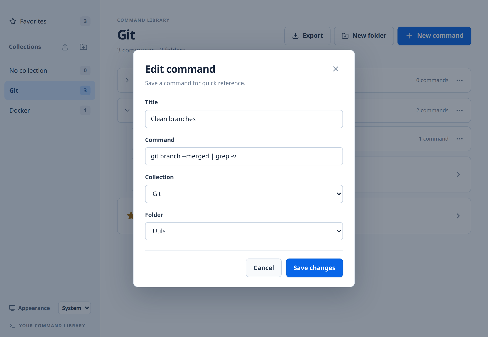

# Command Pad

**Your frequently used commands, organized in one place.**

Command Pad is a lightweight desktop library for saving command snippets and organizing them into collections and nested folders. It keeps your data on your computer and never runs your commands.

[](https://github.com/Renato1478/command-pad/releases/latest)
[](https://github.com/Renato1478/command-pad/actions/workflows/release.yml)

## At a glance

- **Save snippets** with a title and command text.
- **Organize into collections**, with command counts in the sidebar.
- **Nest folders** inside collections and inside other folders.
- **Star favorites** for quick access from the default view.
- **Import and export collections** as JSON files, including folder structure.
- **Edit and move commands** between collections and folders.
- **Keep data local** in a JSON file—no account or server required.
- **Work across platforms** with Tauri's native desktop shell.

### Your command library


### Edit a command



### Organize with folders

Folders appear in the command list as expandable rows. Use the folder menu to add a command, add a subfolder, rename or move the folder, or delete it. Deleting a folder also deletes everything inside it after confirmation.

Commands and folders are sorted alphabetically at every level.

Screenshots show the browser preview with example data.

## Download

Get the latest available installer from the [Releases page](https://github.com/Renato1478/command-pad/releases/latest). Release builds target Linux x64, Windows x64, and macOS on Apple Silicon and Intel. Assets are uploaded as their builds finish.

> Builds are not signed or notarized. Your operating system may display a security warning when you install or open the application.

## Develop

You'll need Node.js 24, Rust, and the [Tauri system prerequisites](https://v2.tauri.app/start/prerequisites/).

```sh
git clone https://github.com/Renato1478/command-pad.git
cd command-pad
npm ci
npm run tauri dev
```

On Ubuntu or Pop!_OS, install the native build dependencies first:

```sh
sudo apt install build-essential pkg-config libgtk-3-dev libwebkit2gtk-4.1-dev \
  libayatana-appindicator3-dev librsvg2-dev patchelf libdbus-1-dev
```

Useful commands:

| Command               | Purpose                                        |
| --------------------- | ---------------------------------------------- |
| `npm run dev`         | Run the UI in a browser                        |
| `npm run build`       | Type-check and build the frontend              |
| `npm run check`       | Check formatting and lint with Biome           |
| `npm test`            | Run UI tests                                   |
| `npm run tauri build` | Build desktop bundles for the current platform |

The browser preview uses localStorage, separate from the desktop app.

## Data and privacy

The desktop app stores `command_pad.json` in Tauri's application data directory. It starts with an empty library and doesn't automatically import data from the separate Iced project. Existing files are migrated automatically when loaded, including older category-based files. Keep backups of that file if your snippets are important.

Use the import button beside **Collections** to import a JSON collection. To export, select a named collection and choose **Export**. Each file contains one collection, its folders, and its commands, including favorite status. Imports create a separate collection even when a collection with the same name already exists. Version 1 collection files without folders remain supported.

Command Pad stores command text for reference; it **does not execute commands**.

### Filesystem workspaces

Use the workspace selector at the top of the sidebar to manage libraries. You can create a workspace automatically in the app data directory, create one in a chosen folder such as a mounted network share, or open an existing workspace. A workspace contains real directories and one Markdown file per command:

```text
team-workspace/
├── .cmdpad/workspace.json
├── collections/
│   └── Git/
│       ├── .collection.json
│       └── Status.cmd.md
└── unfiled/
```

Collections and folders are directories; command names are filenames. Only files ending in `.cmd.md` with valid CmdPad metadata are recognized. Other files are left alone. Workspaces refresh automatically, and edits check the command file for external changes before saving. **Default (this device)** is the original JSON library and is not converted automatically.

## Stack

Built with [Tauri 2](https://tauri.app/), [React](https://react.dev/), [TanStack Router](https://tanstack.com/router), [Tailwind CSS](https://tailwindcss.com/), and [Biome](https://biomejs.dev/).

## Releases

Pushing a `v*` tag creates a GitHub release and starts the [release workflow](.github/workflows/release.yml). Platform builds run independently and attach their bundles to that release. Update the version in `package.json`, `src-tauri/Cargo.toml`, and `src-tauri/tauri.conf.json` before tagging a future release.
