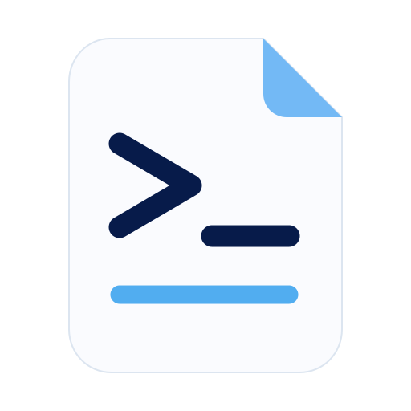
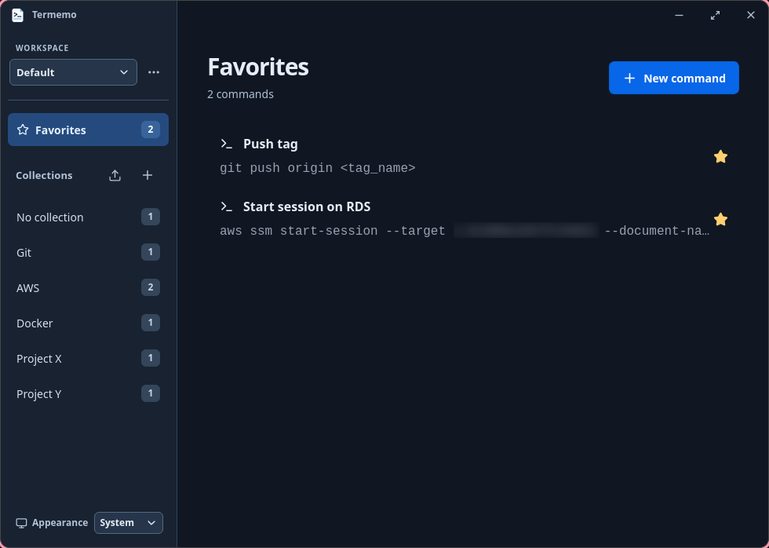

<div align="center">
  
  <h1>Termemo</h1>
  <p><strong>Your commands. Not your memory.</strong></p>
  <p>A small desktop home for the shell commands you keep forgetting.</p>
  <p>
    <a href="https://github.com/Renato1478/termemo/releases/latest">Download</a>
    · <a href="#your-commands-your-files">How it works</a>
    · <a href="#development">Build from source</a>
  </p>
</div>

Ever forget the command to connect to that server? Or how to start the service you haven't touched in a month?

Termemo keeps those commands out of scattered `some-command.txt` files and gives them a home.



## Save it. Find it. Copy it.

1. **Organize** commands into collections and nested folders.
2. **Star your regulars** so they're waiting on the Favorites page.
3. **Open a command and copy it** into your terminal when you need it.

You can also have **separate workspaces** for different projects, machines, or teams. No account or server required.

Termemo stores commands; it **never executes them**. You stay in control of what runs.

## Your commands, your files

Every library is a **workspace**. You can also create a new one in a folder you control (or even in a shared folder with your team) or open an existing workspace.

In a workspace, collections and folders are real directories, and each command is a readable Markdown file:

```text
my-workspace/
├── .cmdpad/workspace.json
├── collections/
│   └── Servers/
│       ├── .collection.json
│       └── Connect to staging.cmd.md
└── unfiled/
```

Termemo recognizes `.cmd.md` files with its metadata and shell code fence.

Collections can also be imported and exported as JSON for sharing.

## Download

**[Get the latest release →](https://github.com/Renato1478/termemo/releases/latest)**

Available for **Linux**, **Windows**, and **macOS** (Intel and Apple Silicon).

Builds are unsigned and not notarized, so your operating system may show a security warning.

## Development

Built with [Tauri 2](https://tauri.app/), [React](https://react.dev/), and Rust.

Install Node.js 24, Rust, and the [Tauri system prerequisites](https://v2.tauri.app/start/prerequisites/), then:

```sh
git clone https://github.com/Renato1478/termemo.git
cd termemo
npm ci
npm run tauri dev
```

`npm run tauri dev` starts both the frontend server and the desktop app.

```sh
npm run check        # Formatting and lint
npm test             # Frontend tests
npm run tauri build  # Desktop bundles for your platform
```

Have an idea or found a bug? [Open an issue](https://github.com/Renato1478/termemo/issues) or send a pull request.
