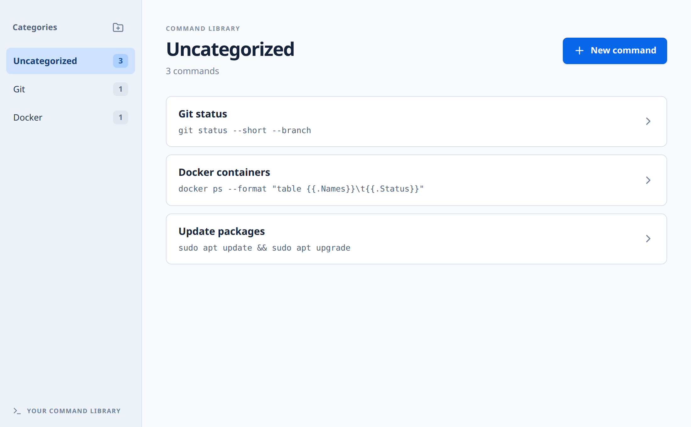

# Command Pad

**Your frequently used commands, organized in one place.**

Command Pad is a lightweight desktop library for saving command snippets and grouping them by category. It keeps your data on your computer and never runs your commands.

[](https://github.com/Renato1478/command-pad/releases/latest)
[](https://github.com/Renato1478/command-pad/actions/workflows/release.yml)

## At a glance

- **Save snippets** with a title and command text.
- **Organize by category**, with command counts in the sidebar.
- **Edit and move commands** between categories whenever you need to.
- **Keep data local** in a JSON file—no account or server required.
- **Work across platforms** with Tauri's native desktop shell.

### Your command library



### Edit a command


Screenshots show the browser preview with example data. The desktop app uses the same interface.

## Download

Get the latest available installer from the [Releases page](https://github.com/Renato1478/command-pad/releases/latest). Release builds target Linux x64, Windows x64, and macOS on Apple Silicon and Intel. Assets are uploaded as their builds finish.

> Builds are not signed or notarized. Your operating system may display a security warning when you install or open the application.

## Develop

You'll need Node.js 24, Rust, and the [Tauri system prerequisites](https://v2.tauri.app/start/prerequisites/).

```sh
git clone https://github.com/Renato1478/command-pad.git
cd command-pad
npm ci
npm run tauri dev
```

On Ubuntu or Pop!_OS, install the native build dependencies first:

```sh
sudo apt install build-essential pkg-config libgtk-3-dev libwebkit2gtk-4.1-dev \
  libayatana-appindicator3-dev librsvg2-dev patchelf libdbus-1-dev
```

Useful commands:

| Command               | Purpose                                        |
| --------------------- | ---------------------------------------------- |
| `npm run dev`         | Run the UI in a browser                        |
| `npm run build`       | Type-check and build the frontend              |
| `npm run check`       | Check formatting and lint with Biome           |
| `npm test`            | Run UI tests                                   |
| `npm run tauri build` | Build desktop bundles for the current platform |

The browser preview uses localStorage, separate from the desktop app.

## Data and privacy

The desktop app stores `command_pad.json` in Tauri's application data directory. It starts with an empty library and doesn't automatically import data from the separate Iced project. Keep backups of that file if your snippets are important.

Command Pad stores command text for reference; it **does not execute commands**.

## Stack

Built with [Tauri 2](https://tauri.app/), [React](https://react.dev/), [TanStack Router](https://tanstack.com/router), [Tailwind CSS](https://tailwindcss.com/), and [Biome](https://biomejs.dev/).

## Releases

Pushing a `v*` tag creates a GitHub release and starts the [release workflow](.github/workflows/release.yml). Platform builds run independently and attach their bundles to that release. Update the version in `package.json`, `src-tauri/Cargo.toml`, and `src-tauri/tauri.conf.json` before tagging a future release.
